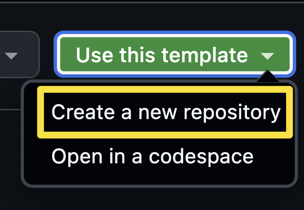

La aplicación GitHub Copilot es una aplicación de escritorio que sirve de centro para Copilot y GitHub. Permite acceder rápidamente a incidencias y solicitudes de incorporación de cambios y desarrollar con GitHub Copilot. Durante el taller trabajarás en local con la aplicación Tailspin Toys, creada con Astro. Antes de empezar, comprueba que Node.js esté instalado localmente y, después, instala la aplicación Copilot.

En esta lección, harás lo siguiente:

- Instalarás Node.js para ejecutar las pruebas del proyecto en tu equipo.
- Crearás una copia del proyecto Tailspin Toys a partir de la plantilla.

## Instala Node.js

En varias lecciones pedirás a un agente que desarrolle funcionalidades y ejecute el conjunto de pruebas de Tailspin Toys en local. Para ello necesitas [Node.js][nodejs], el único entorno de ejecución que requiere el proyecto. Instala la versión **LTS** actual.

La opción más sencilla en cualquier sistema operativo es usar el instalador oficial:

1. Abre un terminal en tu sistema operativo, como Windows Terminal, Terminal de macOS o la aplicación que utilices habitualmente.
2. Ejecuta estos comandos para comprobar las versiones instaladas:

   ```shell
   node --version
   npm --version
   ```

3. Si ambos comandos se ejecutan correctamente y Node.js cumple los requisitos del archivo `README` y de `package.json` del proyecto, pasa a la sección siguiente.

> [!TIP]
> Completa estos pasos solo si no tienes Node.js instalado o necesitas actualizarlo.

4. Abre la [página de descarga de Node.js][node-download].
5. Descarga la versión **LTS** para tu sistema operativo.
6. Ejecuta el instalador y acepta las opciones predeterminadas. En Windows, deja seleccionada la opción **Add to PATH**.
7. Cuando termine la instalación, abre un terminal nuevo.
8. En el terminal nuevo, confirma la instalación:

   ```bash
   node --version
   npm --version
   ```

9. Comprueba que aparecen las versiones instaladas de Node.js y npm.

> [!IMPORTANT]
> El agente de la aplicación Copilot también debe poder ejecutar `node --version` y `npm --version`. Que funcionen en el terminal habitual no garantiza que estén disponibles en la aplicación. Cierra completamente y vuelve a abrir la aplicación después de instalar Node.js o cambiar `PATH`. Si alguno de los comandos sigue fallando en una sesión, sigue los [pasos para solucionar problemas del entorno de sesión][session-environment] antes de continuar.

> [!IMPORTANT]
> Cada árbol de trabajo también necesita las dependencias del proyecto y Chromium de Playwright para las pruebas de extremo a extremo (E2E). Sigue el archivo `README` del repositorio de Tailspin Toys para preparar un árbol de trabajo y revisa cualquier solicitud de instalación antes de aprobarla.

## Configura el repositorio del taller

Trabajarás con tu propia copia del proyecto Tailspin Toys. Créala ahora a partir del [repositorio de plantilla][template-repository]. La copia contiene todos los archivos necesarios y la conectarás al instalar la aplicación.

1. En una ventana nueva del navegador, ve al repositorio del taller: `https://github.com/github-samples/tailspin-toys`.
2. Selecciona **Use this template** y, después, **Create a new repository**.

   

3. Si participas en un evento organizado por GitHub o Microsoft, sigue las instrucciones de los mentores. Si no, puedes crear el repositorio en una organización en la que tengas acceso a GitHub Copilot.

   

4. Anota la ruta del repositorio que has creado (`organization-or-user-name/repository-name`); la necesitarás más adelante.

> [!NOTE]
> Al crear el repositorio a partir de la plantilla, se genera automáticamente un backlog de incidencias de GitHub. Trabajarás con esas incidencias durante el taller; no hace falta que crees ninguna.

Usa una copia nueva de la plantilla del taller. Incluye instrucciones del repositorio, código de la aplicación, pruebas, la habilidad `quality-checks` y una extensión de lienzo existente. Durante el taller personalizarás la habilidad y crearás un agente de control de calidad (QA). Si usas una copia anterior, comprueba con quien imparte el taller que incluya los archivos necesarios.

## Resumen y siguientes pasos

Ya tienes el entorno preparado. En esta lección:

- Instalaste Node.js para compilar y probar el proyecto en tu equipo.
- Creaste una copia del repositorio Tailspin Toys a partir de la plantilla.

A continuación, [instalarás la aplicación GitHub Copilot][next-lesson], conectarás el repositorio y te familiarizarás con el espacio de trabajo.

## Recursos

- [Descargar Node.js][node-download]
- [Crear un repositorio a partir de una plantilla][template-repository]
- [Acerca de la aplicación GitHub Copilot][about-copilot-app]

[next-lesson]: ../1-install-copilot-app/
[nodejs]: https://nodejs.org/
[node-download]: https://nodejs.org/en/download
[template-repository]: https://docs.github.com/repositories/creating-and-managing-repositories/creating-a-template-repository
[about-copilot-app]: https://docs.github.com/copilot/concepts/agents/github-copilot-app
[session-environment]: ../3-agent-modes/#iniciar-una-sesion-desde-la-incidencia
